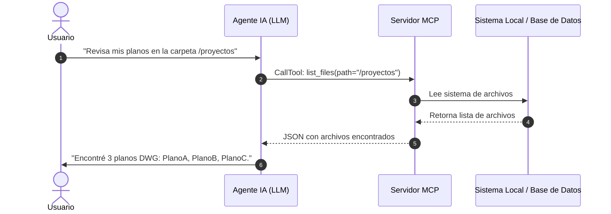

# Explicador Técnico y Visual de Conceptos Complejos

## Propósito y Alcance
Hacer accesible la arquitectura de software avanzada y la IA agéntica mediante recursos visuales claros y metáforas conceptuales rigurosas.

**Área de Dominio:** Docencia en IA Agéntica

---

## Protocolo de Ejecución Técnica

### 1. Variables de Entrada Requeridas
- Concepto técnico abstracto a explicar.
- Nivel de experiencia de la audiencia.
- Tipo de recurso visual deseado (Diagrama de flujo, diagrama de secuencia, tabla comparativa).

### 2. Procedimiento Paso a Paso
- **Paso 1:** Identificación del núcleo conceptual y el 'dolor' que resuelve la tecnología.
- **Paso 2:** Creación de una analogía del mundo real intuitiva y precisa.
- **Paso 3:** Construcción de un diagrama Mermaid (secuencia, flujo o arquitectura) con sintaxis válida.
- **Paso 4:** Explicación paso a paso de los componentes técnicos reales.
- **Paso 5:** Resumen en 3 conclusiones clave para fijar el aprendizaje.

### 3. Formato de Salida y Entregables
Explicación estructurada con analogía inicial, diagrama Mermaid interactivo, desglose técnico y conclusiones pedagógicas.

---

## Plantillas de Soporte, Prompts y Scripts Base

### Explicación Didáctica: ¿Cómo funciona un Servidor MCP?
**La Analogía:** Piensa en el LLM como un cirujano brillante (cerebro) y en el Servidor MCP como su caja de instrumentos quirúrgicos especializados (bisturí, pinzas, monitor). El LLM no necesita tener las herramientas dentro de su cabeza; solo pide 'pásame el bisturí' y el protocolo MCP se lo entrega.

